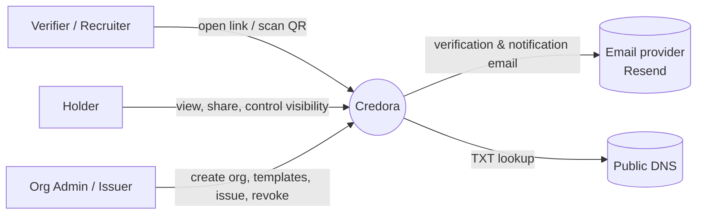
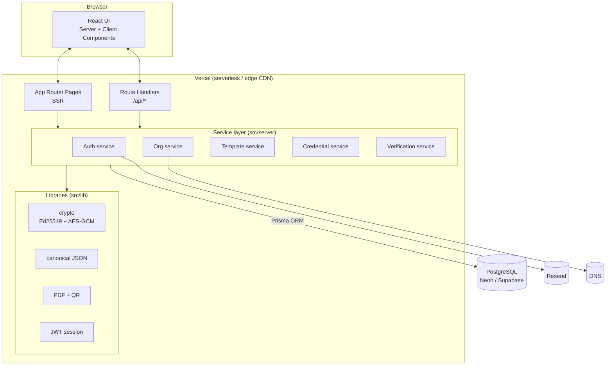
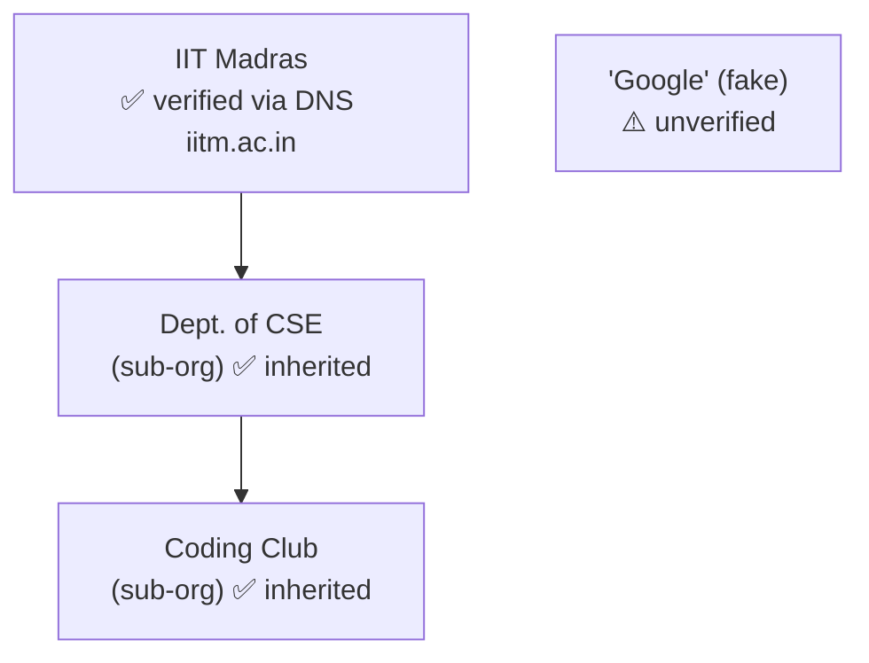
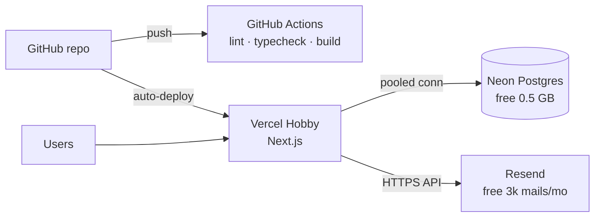

# 02 · High-Level Design (HLD)

## 1. System context

## 2. Architecture

A single **Next.js** (App Router) application hosts both the frontend (React Server + Client Components)
and the backend (Route Handlers under `/api`). Business logic lives in a framework-agnostic **service layer**
so it can later be extracted into a standalone service.

### Why a modular monolith?
- One deployable → fits free hosting, zero inter-service latency.
- Clear layering (route → service → lib/db) keeps it splittable later.

## 3. Key components

| Component | Responsibility |
|-----------|----------------|
| **Pages (SSR)** | Public profile `/u/[handle]`, verify page `/c/[id]`, org page, dashboards. Read directly via services. |
| **Route handlers** | JSON REST API for all mutations + public verification API. Validate input (Zod), resolve session, call service. |
| **Auth service** | Register, login, email verification, session cookie, claiming pending credentials. |
| **Org service** | Org/sub-org CRUD, membership & roles, domain verification, key-pair generation. |
| **Template service** | Template CRUD with custom field schema + signatories. |
| **Credential service** | Build canonical payload → hash → sign → persist; bulk issue; revoke; visibility. |
| **Verification service** | Recompute hash, verify signature with org public key, compute status (valid / revoked / expired / tampered). |
| **Crypto lib** | Ed25519 key generation/sign/verify (Node `crypto`), AES-256-GCM encryption of private keys with `MASTER_KEY`. |

## 4. Trust model

1. **Org identity** — verified by proving control of a DNS domain (TXT record).
2. **Hierarchy** — a sub-org can only be created by an admin of the parent, so trust flows downward.
3. **Credential integrity** — every credential is signed with the issuing org's Ed25519 private key.
   Anyone with the public key can verify, even offline.
4. **Revocation** — status is checked live against the platform.

## 5. Core flows (summary)

| Flow | Steps |
|------|-------|
| Issue | Issuer → `POST /api/orgs/{slug}/credentials` → authz(ISSUER) → validate fields against template → canonical payload → SHA-256 → Ed25519 sign → insert → audit log |
| Verify | Visitor → `/c/{id}` → load credential + org → rebuild payload → compare hash → verify signature → status badge |
| Claim | User verifies email → all credentials with `recipientEmail = email AND recipientId IS NULL` linked to user |
| Domain verify | Admin sets domain → adds TXT `credora-verify=<token>` → `POST verify` → DNS lookup → mark VERIFIED |

Detailed sequence diagrams are in [03-lld.md](03-lld.md).

## 6. Deployment (free tier)

| Layer | Free option | Alternative |
|-------|-------------|-------------|
| App hosting | Vercel Hobby | Netlify, Render |
| Database | Neon | Supabase Postgres |
| Email | Resend | Console log in dev |
| CI | GitHub Actions | — |

## 7. Scalability path

- Read-heavy verify page → add `Cache-Control` / ISR with on-revoke revalidation.
- Bulk issuance > 500 rows → move to a queue (Upstash QStash) + background worker.
- Key management → move private keys to a KMS (AWS KMS / GCP KMS) with `keyId` rotation.
- Rate limiting → Upstash Redis instead of in-memory.
