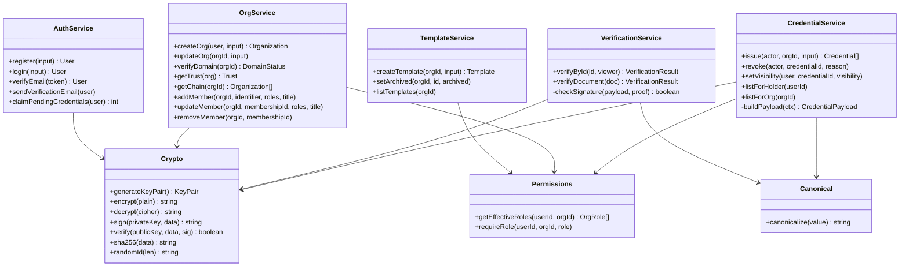
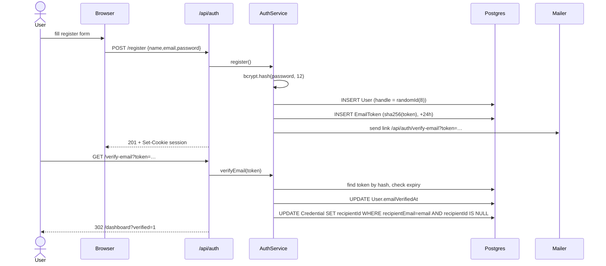
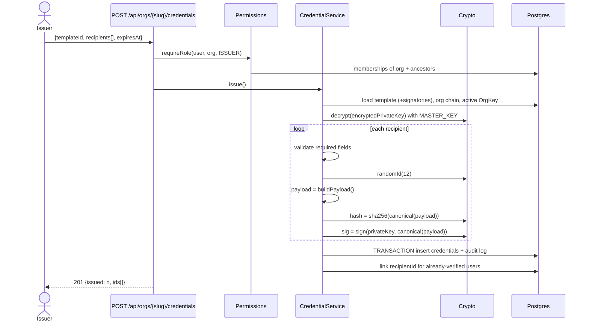
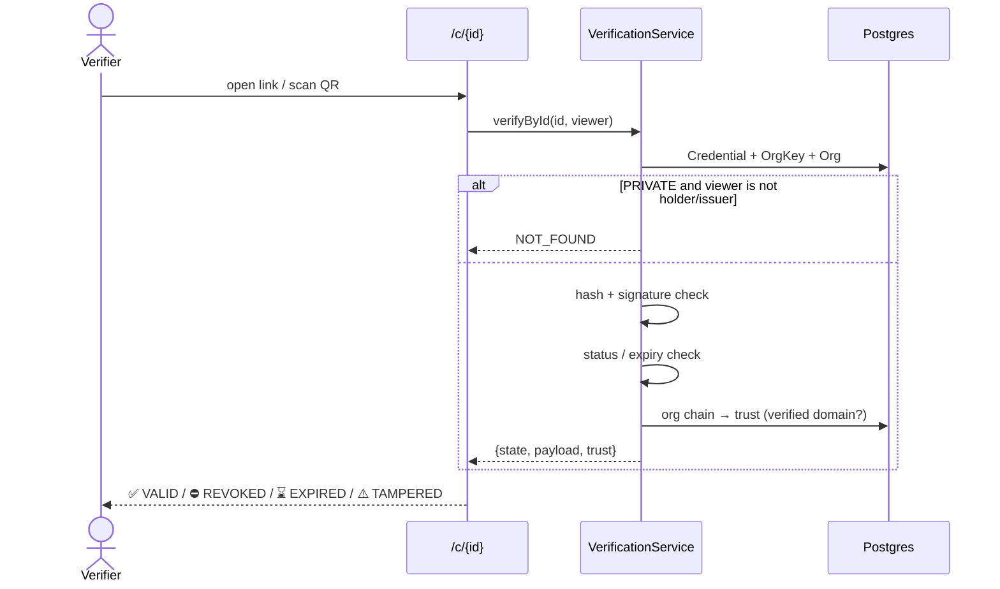
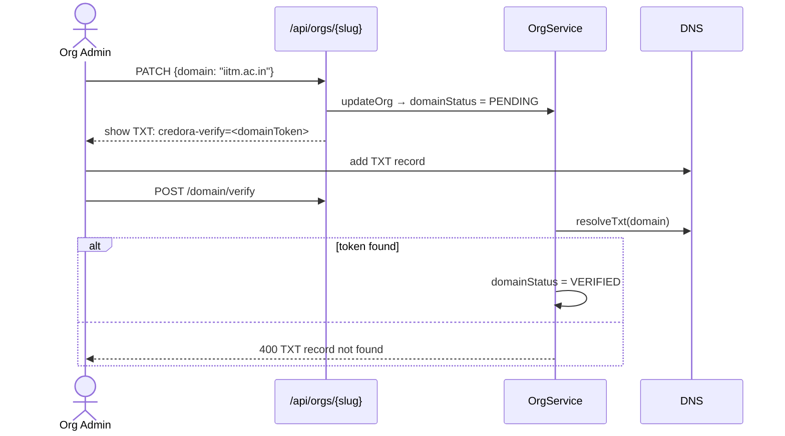
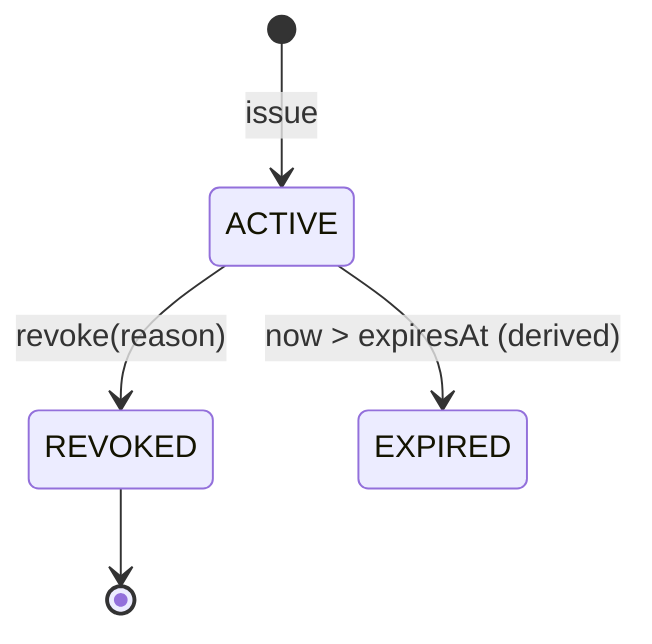
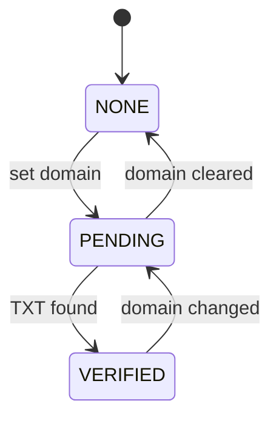

# 03 · Low-Level Design (LLD)

## 1. Source layout

```text
src/
├── app/                          # Next.js App Router
│   ├── (pages)                   # /, /login, /register, /dashboard, /settings, /verify
│   ├── orgs/new                  # create org / sub-org
│   ├── orgs/[slug]               # public org page
│   ├── orgs/[slug]/manage        # admin console (tabs)
│   ├── u/[handle]                # public holder profile
│   ├── c/[id]                    # credential verification page
│   └── api/**                    # REST route handlers (thin)
├── components/                   # React components (client + server)
├── server/                       # Service layer — business rules, no HTTP
│   ├── auth.service.ts
│   ├── org.service.ts
│   ├── template.service.ts
│   ├── credential.service.ts
│   ├── verification.service.ts
│   ├── permissions.ts
│   └── audit.ts
└── lib/                          # Pure utilities / infrastructure
    ├── db.ts                     # Prisma singleton
    ├── env.ts                    # validated env vars
    ├── session.ts                # JWT cookie session
    ├── crypto.ts                 # Ed25519, AES-GCM, SHA-256, random ids
    ├── canonical.ts              # deterministic JSON
    ├── http.ts                   # route wrapper, ApiError, JSON helpers
    ├── validators.ts             # Zod schemas (shared FE/BE)
    ├── csv.ts                    # RFC-4180-ish CSV parser
    ├── pdf.ts                    # PDF + QR rendering
    ├── mail.ts                   # Resend / console mailer
    └── rate-limit.ts             # in-memory sliding window
```

**Layer rule:** `app/api → server → lib → db`. Route handlers never touch Prisma directly; services never read
`Request`/cookies.

## 2. Class / module diagram



## 3. Signed credential document

The **payload** is the only source of truth for what was certified. It is stored verbatim (`Credential.payload`)
and rendered on the verify page. Mutable columns (`status`, `visibility`) are *not* part of the signature.

```jsonc
{
  "payload": {
    "v": 1,
    "id": "7KQ2XM9PA3DF",
    "type": "EVENT",
    "title": "Winner – HackNight 2026",
    "description": "Awarded for first place …",
    "issuer": {
      "id": "clx…", "slug": "coding-club", "name": "Coding Club",
      "chain": ["IIT Madras", "Dept. of CSE", "Coding Club"]
    },
    "recipient": { "name": "Asha Rao", "emailHash": "sha256(lower(email):id)" },
    "fields": [ { "label": "Position", "value": "1st" } ],
    "signatories": [ { "name": "R. Kumar", "title": "Faculty Advisor" } ],
    "issuedAt": "2026-11-01T10:00:00.000Z",
    "expiresAt": null,
    "keyId": "key_…"
  },
  "proof": {
    "type": "Ed25519Signature",
    "keyId": "key_…",
    "hash": "<hex sha256 of canonical(payload)>",
    "signature": "<base64 Ed25519 signature over canonical(payload)>"
  }
}
```

**Canonicalisation:** objects → keys sorted lexicographically, no whitespace; arrays keep order; `undefined`
dropped. Guarantees the same bytes regardless of DB JSON key order.

**Verification algorithm**

```text
1. key  = OrgKey[proof.keyId]                       (never trust a key supplied by the client)
2. if key.orgId != payload.issuer.id → TAMPERED
3. bytes = canonicalize(payload)
4. if sha256(bytes) != proof.hash → TAMPERED
5. if !ed25519.verify(key.publicKey, bytes, proof.signature) → TAMPERED
6. if credential.status == REVOKED → REVOKED
7. if payload.expiresAt && now > expiresAt → EXPIRED
8. → VALID
```

## 4. Sequence diagrams

### 4.1 Register + email verification + claim



### 4.2 Issue credential(s)



### 4.3 Verify



### 4.4 Domain verification



## 5. Authorisation matrix

Effective roles = direct membership roles ∪ (`ADMIN`, `ISSUER` if user is `ADMIN` of any ancestor org).

| Action | ADMIN | ISSUER | SIGNATORY | Holder | Public |
|--------|:-----:|:------:|:---------:|:------:|:------:|
| Update org, verify domain | ✅ | | | | |
| Create sub-org | ✅ | | | | |
| Manage members | ✅ | | | | |
| Create / archive template | ✅ | ✅ | | | |
| Issue / revoke credential | ✅ | ✅ | | | |
| Be listed as signatory | | | ✅ (direct member) | | |
| Change credential visibility | | | | ✅ | |
| View PUBLIC / UNLISTED credential | ✅ | ✅ | ✅ | ✅ | ✅ |
| View PRIVATE credential | ✅ | ✅ | | ✅ | |

Invariant: an org must always keep at least one direct `ADMIN`.

## 6. State machines





## 7. Identifiers

| Entity | Format | Example | Notes |
|--------|--------|---------|-------|
| User handle | 8 chars Crockford base32 | `K7Q2XM9P` | public, immutable, ~10¹² space |
| Credential id | 12 chars Crockford base32 | `7KQ2XM9PA3DF` | public, unguessable (~10¹⁸) |
| Org slug | `[a-z0-9-]{3,40}` | `coding-club` | user chosen, unique |
| Key id | `key_` + 16 chars | `key_9F3K…` | supports rotation |

Crockford base32 (`0-9 A-Z` minus `I L O U`) avoids ambiguous characters when read aloud / typed from paper.

## 8. Error model

All API errors: `{"error": {"code": "FORBIDDEN", "message": "…"}}` with matching HTTP status.

| Code | HTTP |
|------|------|
| `VALIDATION_ERROR` | 400 |
| `UNAUTHENTICATED` | 401 |
| `FORBIDDEN` | 403 |
| `NOT_FOUND` | 404 |
| `CONFLICT` | 409 |
| `RATE_LIMITED` | 429 |
| `INTERNAL` | 500 |
