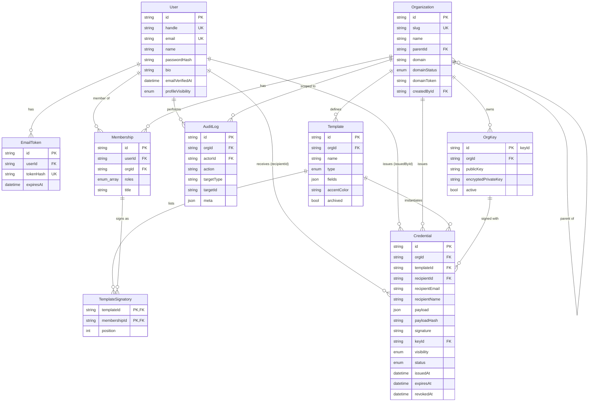

# 04 · Database Design

PostgreSQL via Prisma ORM. Source of truth: [`prisma/schema.prisma`](../prisma/schema.prisma).

## 1. ER diagram

## 2. Enums

| Enum | Values |
|------|--------|
| `ProfileVisibility` | `PUBLIC`, `PRIVATE` |
| `CredentialVisibility` | `PUBLIC`, `UNLISTED`, `PRIVATE` |
| `CredentialStatus` | `ACTIVE`, `REVOKED` (EXPIRED is derived) |
| `CredentialType` | `COURSE`, `EVENT`, `PARTICIPATION`, `ACHIEVEMENT`, `EMPLOYMENT`, `INTERNSHIP`, `DEGREE`, `MEMBERSHIP`, `OTHER` |
| `OrgRole` | `ADMIN`, `ISSUER`, `SIGNATORY` |
| `DomainStatus` | `NONE`, `PENDING`, `VERIFIED` |

## 3. Tables

### User
| Column | Type | Constraints |
|--------|------|-------------|
| id | text | PK (cuid) |
| handle | text | UNIQUE — public identity key |
| email | text | UNIQUE, stored lower-case |
| name | text | NOT NULL |
| passwordHash | text | bcrypt, cost 12 |
| bio | text | nullable |
| emailVerifiedAt | timestamptz | nullable |
| profileVisibility | enum | default `PUBLIC` |

### Organization
| Column | Type | Constraints |
|--------|------|-------------|
| id | text | PK |
| slug | text | UNIQUE |
| parentId | text | FK → Organization.id, nullable, INDEX |
| domain | text | nullable |
| domainStatus | enum | default `NONE` |
| domainToken | text | random, shown as TXT value |
| createdById | text | FK → User.id |

### OrgKey
Private key is **AES-256-GCM encrypted** with `MASTER_KEY` (env). Format `iv.authTag.ciphertext` (base64).
Public key stored as base64 SPKI DER. `active = true` for the key used for new issuance; old keys are kept to
verify older credentials.

### Membership
`roles` is a Postgres enum array (`OrgRole[]`). `UNIQUE(userId, orgId)` – one row per user per org.

### Template
`fields` JSON: `[{ "key": "position", "label": "Position", "required": true }]`.

### Credential
| Column | Notes |
|--------|-------|
| id | 12-char public id (PK) |
| payload | exact signed JSON (immutable) |
| payloadHash | hex SHA-256 of canonical payload |
| signature | base64 Ed25519 signature |
| keyId | FK → OrgKey.id |
| recipientEmail | lower-case; used for claim. Never exposed publicly |
| recipientId | nullable until claimed |
| visibility / status | mutable, **not** signed |

### AuditLog
Append-only record of security-relevant actions (`ORG_CREATED`, `MEMBER_ADDED`, `CREDENTIAL_ISSUED`,
`CREDENTIAL_REVOKED`, `DOMAIN_VERIFIED`, …).

## 4. Indexes

| Table | Index | Query served |
|-------|-------|--------------|
| Credential | `(recipientId)` | holder dashboard / profile |
| Credential | `(recipientEmail)` | claim on email verification |
| Credential | `(orgId, issuedAt DESC)` | org credentials list |
| Membership | `(orgId)` | members list, permission check |
| Organization | `(parentId)` | sub-org list, chain walk |
| Template | `(orgId)` | template list |
| OrgKey | `(orgId)` | active key lookup |
| AuditLog | `(orgId, createdAt)` | activity feed |

## 5. Data integrity rules

- `Credential.payload`, `payloadHash`, `signature`, `keyId` are written once and never updated.
- Deleting a `Membership` cascades `TemplateSignatory`; credentials keep their signatory snapshot in the payload.
- Organisations and credentials are never hard-deleted (revocation instead) — required for verifiability.
- Email tokens are stored hashed; raw token exists only in the email link.
